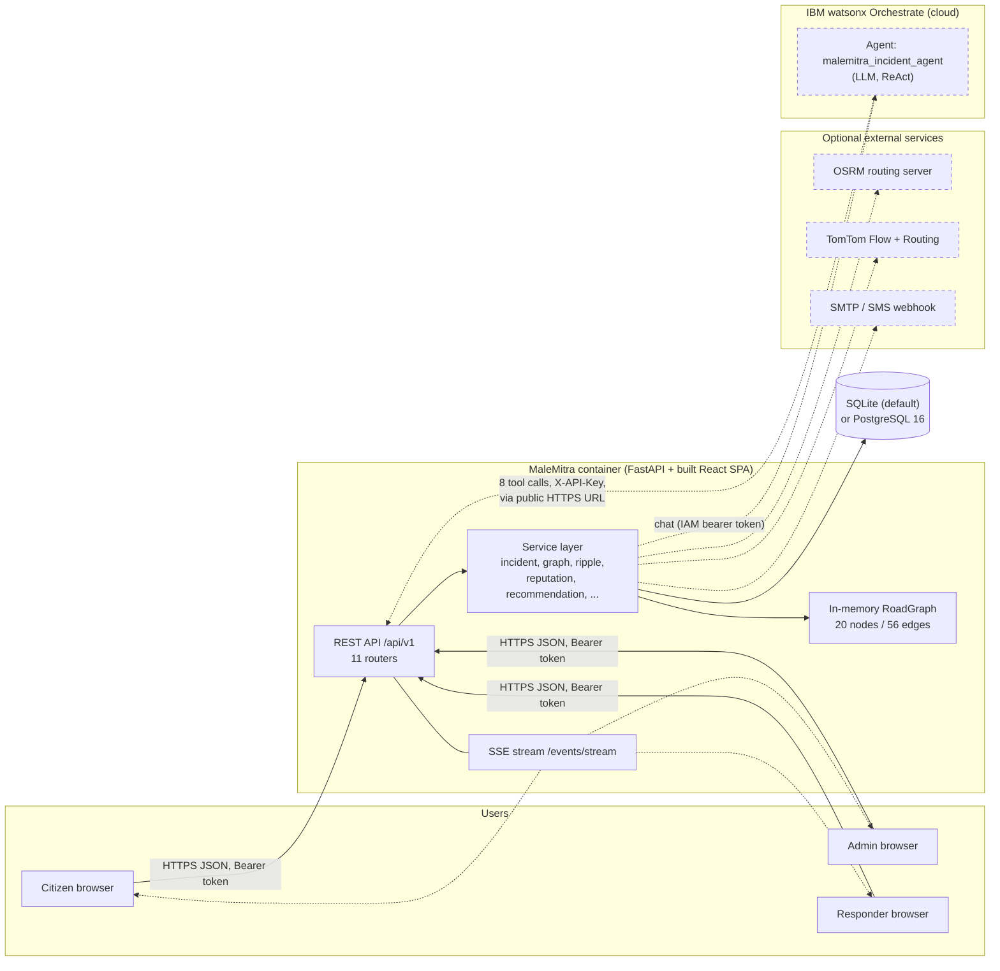
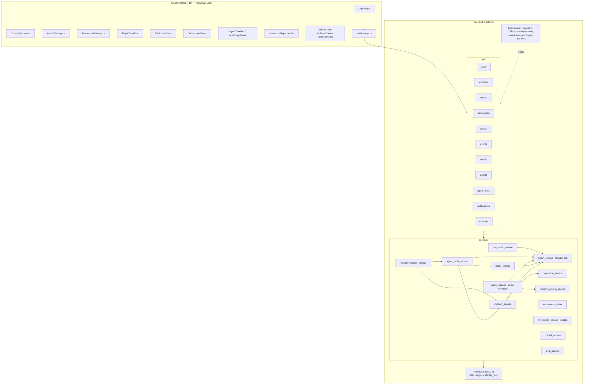
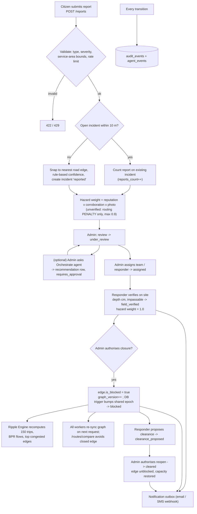
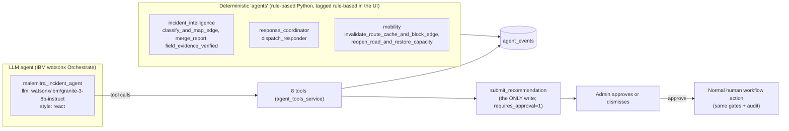
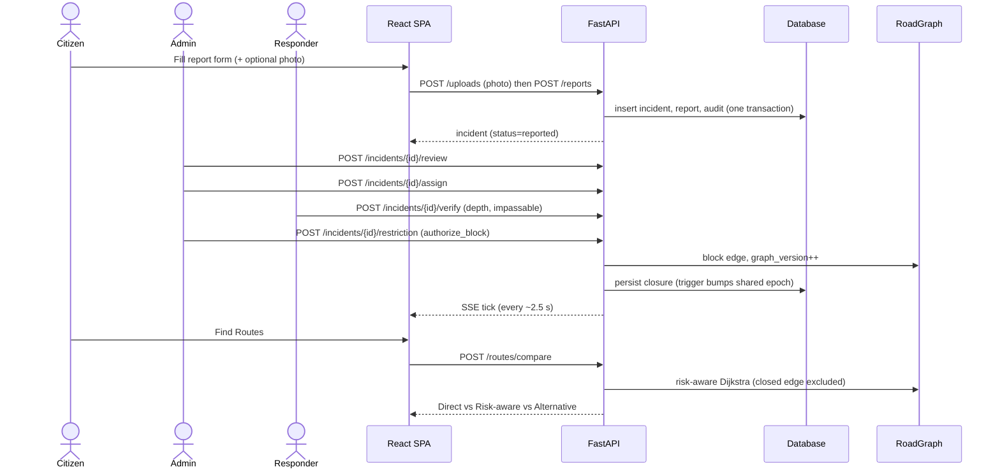
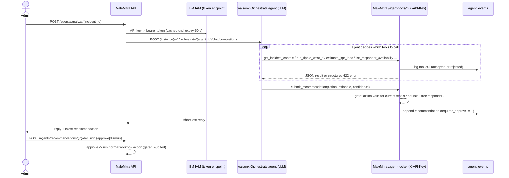

# 03 · Technical Architecture

All diagrams below were derived from the code in this repository (commit `cdafc7d`). Components that exist only as options (OSRM, TomTom, SMTP, Orchestrate) are drawn with dashed borders. Nothing is shown that is not in the code.

## 1. High-level architecture

MaleMitra is a **modular monolith**: one FastAPI application serves both the JSON API (`/api/v1`) and the pre-built React single-page app.

## 2. Application component architecture

## 3. End-to-end data flow

## 4. AI agent workflow (what is rule-based vs LLM)

The agent's LLM model name above is what is written in `orchestrate/malemitra_incident_agent.yaml`; the model actually configured in the team's Orchestrate instance **[TEAM INPUT REQUIRED]**.

## 5. User interaction sequence (citizen report to rerouted commuter)

## 6. watsonx Orchestrate integration and workflow

## 7. System components

| Component | Responsibility | File(s) |
|---|---|---|
| App factory & middleware | Lifespan (prod-safety check, DB init, restore closures, start background workers), request ID, security headers/CSP, graph sync | `main.py` |
| Config | 60+ env settings; `production_problems()` refuses unsafe prod config | `config.py` |
| Auth | scrypt password hashes, HMAC-signed expiring tokens with per-account version, lockout, roles | `api/auth.py`, `security.py` |
| Rate limits | DB-backed counters shared by all workers | `ratelimit.py` |
| Incident workflow | 8-state machine, merging, assignment, verification, closure | `services/incident_service.py` |
| Road graph | Nodes/edges, nearest-edge snap, Dijkstra/Yen, BPR cost | `services/graph_service.py` |
| Ripple Engine | Re-route 150 synthetic trips, BPR delay, per-edge deltas, what-if | `services/ripple_service.py` |
| Route comparison | OSRM geometry, closure-aware detour, TomTom ETA | `services/agent_service.py` (class `AgentOrchestrator`) |
| Reputation | Reporter trust scoring | `services/reputation_service.py` |
| Agent tool layer / client / recommendations | See §6 | `agent_tools*.py`, `orchestrate_client.py`, `recommendation_service.py` |
| Live traffic | TomTom flow poller with leases, budgets | `live_traffic_service.py`, `tomtom_routing_service.py` |
| Notifications | Transactional outbox, SMTP + signed webhook, retry | `notification_service.py` |
| Uploads | Validate/strip images | `upload_service.py` |
| Shared state | Epoch + leases across workers | `shared.py` |

## 8. Frontend architecture

React 19 SPA (TypeScript, Vite 6). Four role-driven views in `App.tsx` (`citizen`, `admin`, `responder`, plus admin-only `ripple` and `evaluation`). State: `AuthContext` (token in `localStorage`), `IncidentContext` (incidents, road network, SSE via `EventSource('/api/v1/events/stream')`). Map: Leaflet with OpenStreetMap tiles. Styling: inline styles (no CSS framework; the README's mention of Tailwind is **not supported by `package.json`**). Voice: browser `speechSynthesis`. Largest files: `CitizenWorkspace.tsx` (1,719 lines), `InteractiveMap.tsx` (702).

## 9. Backend architecture

FastAPI with synchronous route handlers (run in a thread pool), Pydantic v2 request models with enum/length/bounds validation, a service layer, and direct SQL (no ORM) via a thin `get_db_connection()` that abstracts SQLite and PostgreSQL. Middleware wraps every request: shared-state sync → handler → logging and security headers. Static SPA is mounted from `frontend/dist` when present.

## 10. Database architecture

14 domain tables plus `schema_info` (version guard: refuses to start on a newer schema). Created with `CREATE TABLE IF NOT EXISTS` at startup (advisory lock on PostgreSQL).

| Table | Purpose |
|---|---|
| `users`, `password_reset_tokens` | Accounts; hashed reset tokens |
| `response_teams` | Team Alpha / Beta and availability |
| `incidents`, `incident_reports`, `incident_evidence` | Incident record, each citizen report, field evidence |
| `agent_events` | Rule-based agent steps **and** Orchestrate tool calls/recommendations (with `requires_approval`, `decision`) |
| `audit_events` | Before/after state of every mutation |
| `notifications` | Outbox with attempts/backoff |
| `rate_hits`, `shared_state`, `leases` | Cross-worker rate limits, epochs, leader election |
| `uploads` | Photo metadata |
| `simulation_runs` | Ripple results |

Database triggers bump the `graph` epoch inside the same transaction as any incident change that can affect roads, so another worker cannot miss a closure. Foreign keys are not declared (documented limitation).

## 11. API architecture

REST over JSON under `/api/v1`, OpenAPI at `/docs`. 53 operations: auth (9), reports (1), incidents (9), routes (2), simulations (5, including `/simulations/latest`), teams (4), events (3), agents (5), agent-tools (8; the `/agent-tools/spec` helper is excluded from the schema), notifications (3), uploads (2), health (1), traffic (1). Full list: [07](07_API_DOCUMENTATION.md).

## 12. AI architecture

Two layers by design:

1. **Deterministic engine** — snapping, confidence, duplicate merge, trust weights, Dijkstra/Yen, BPR, ripple. Predictable, testable, no LLM.
2. **LLM agent layer** — the Orchestrate agent decides *which* tools to call and writes the rationale; tools themselves are deterministic.

## 13. IBM technology integration

See [04](04_IBM_TECHNOLOGY_AND_AGENTIC_AI.md).

## 14. External service integrations

| Service | Used for | If unavailable |
|---|---|---|
| watsonx Orchestrate + IBM IAM | Agent reasoning | Panel shows "Not connected"; all other features work (verified in SS-run and tests) |
| OSRM | Road geometry, turn-by-turn | Circuit breaker (3 failures → 60 s) then graph geometry (visible in SS11 "Graph fallback") |
| TomTom Flow / Routing | Live congestion and ETAs | Time-of-day multiplier ("Typical Traffic" banner) |
| OpenStreetMap tiles, Nominatim | Map, geocoding | Map blank / search fails (browser side) |
| SMTP, SMS webhook | Notifications | Messages only logged |

## 15. Authentication and authorisation

- Password: scrypt with salt; legacy hashes upgrade on login.
- Session: HMAC-signed token with expiry (default 8 h) and per-account version; logout/password change revoke all tokens; 5 failures → 15-min lockout; per-IP login rate limit.
- Roles: `citizen`, `responder`, `admin` via `require_role([...])` dependency on every operational route.
- Agent tools: separate shared secret `X-API-Key` (`AGENT_TOOL_API_KEY`), compared in constant time, **disabled until set**.
- `ALLOW_LEGACY_TOKENS` (bare user-id bearer) exists for tests/local demo only; `production_problems()` blocks it when `DEMO_MODE=false`.

Role matrix: [07](07_API_DOCUMENTATION.md#role-matrix).

## 16. Request lifecycle

1. Middleware assigns request ID; if shared sync is on and path is under `/api/v1`, `shared.sync_graph()` compares epochs and rebuilds the graph if another worker changed it.
2. Router dependency resolves the user and role.
3. Pydantic validates the body.
4. Service executes the transaction, writes `audit_events`/`agent_events`, and may queue notifications in the same transaction.
5. Response gets `X-Request-ID`, `X-Content-Type-Options`, `X-Frame-Options: DENY`, `Referrer-Policy`, `Permissions-Policy`, CSP (not on `/docs`), HSTS on HTTPS.

## 17. Error handling

| Case | Behaviour |
|---|---|
| Validation | 422 with details; out-of-area coordinates rejected rather than routed wrongly |
| Auth | 401 (missing/invalid) · 403 (wrong role) · 429 (rate limit) |
| Agent tool guardrail | 422 `{"error": "workflow_gate" \| "incident_closed" \| "not_found" \| ..., "message": ...}`; logged |
| Orchestrate down/unconfigured | 503/502 with message; app keeps working |
| OSRM/TomTom failure | Circuit breakers + fallback |
| Unhandled exception | Logged with request id; 500 |
| Health | `/api/v1/health` checks DB and graph; 503 when unhealthy |

## 18. Deployment architecture

| Target | Files | Notes |
|---|---|---|
| Local dev | `uvicorn backend.app.main:app` + `npm run dev` | SQLite |
| Docker Compose | `docker-compose.yml` | App + PostgreSQL 16 + OSRM (download → prepare → serve) |
| Render | `render.yaml` | Free Docker web service; hardening flags pre-set; live at `malemitra.onrender.com` (HTTP 200 on 15 Nov) |
| IBM Cloud Code Engine | `scripts/deploy_code_engine.sh`, `.ceignore` | One app, SQLite, `--min-scale 1 --max-scale 1` |
| CI | `.github/workflows/ci.yml` | pytest on SQLite and PostgreSQL, ruff, frontend build, docker build |

Container: multi-stage (Node 22 build → Python 3.11-slim), non-root uid 10001, healthcheck, `WEB_CONCURRENCY=2`.

## 19. Scalability considerations

- **Implemented:** PostgreSQL option with pooled connections; shared epoch so N workers/replicas agree on closures (tested with separate processes); DB-backed rate limits; lease-elected TomTom poller; SSE cap (`MAX_SSE_CLIENTS`).
- **Not done:** no load test; PostgreSQL itself is single-node; no metrics/alerting; per-process route and OSRM caches; closures reach other workers on their next request (≈ seconds).
- **Scaling path:** bigger modelled graph or graph built from OSM; message queue for notifications; metrics; read replicas.
