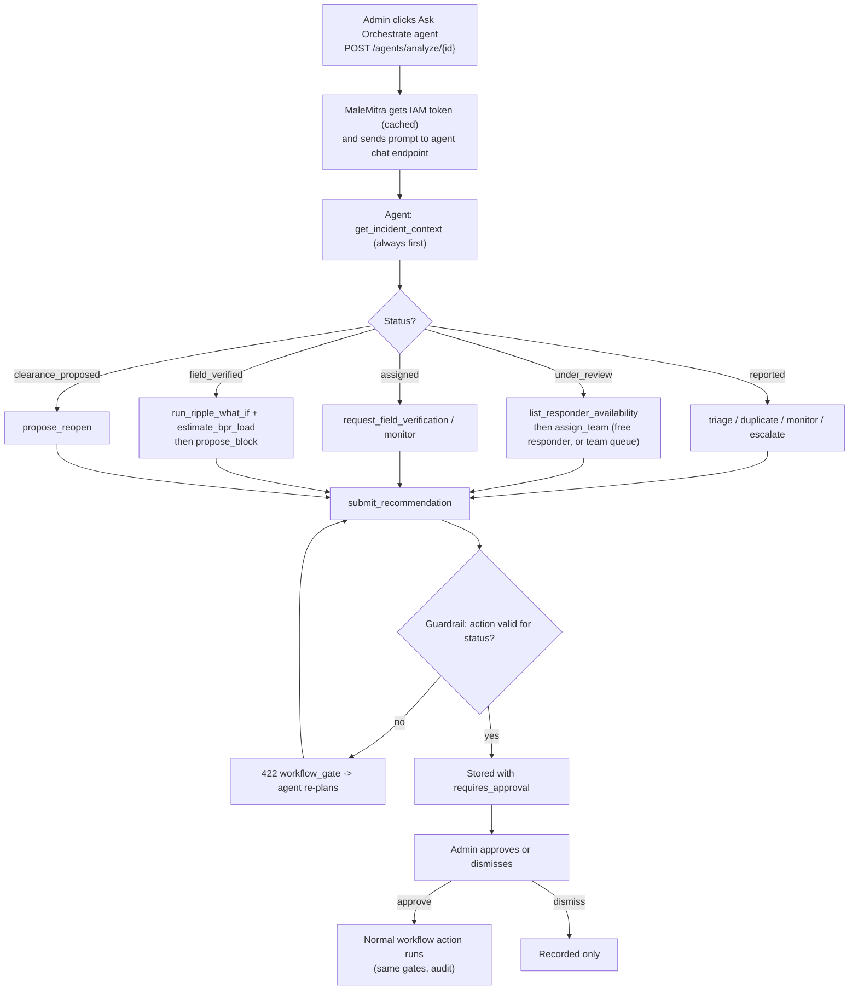

# 04 · IBM Bob and watsonx Orchestrate — Usage and Agentic AI

Both products are **required** by the official rules (§8.1: "all Submissions must demonstrate use of them"). This document separates what is *proven in the repository*, what the team has *told us*, and what is *still pending evidence*.

| Marker | Meaning |
|---|---|
| ✅ VERIFIED | Observed in code, or by running a check on 15 Nov 2026 |
| 🟦 USER-STATED | Told to us by the team; not provable from the repo |
| 📸 EVIDENCE PENDING | Team must add screenshot/export (placeholder given) |

---

# Part A — IBM Bob

> **"Built with IBM Bob" is the core participation requirement.** Teams submit the problem, the prototype, **a short Bob story demo showing how Bob was used throughout development**, and one measurable outcome. The three-beat Bob story outline (start, build and fix, review and trust) is in [00 Participation requirements](00_PARTICIPATION_REQUIREMENTS.md#1-the-bob-story-is-the-centre-of-the-submission) and in video segment 6 of [15](15_VIDEO_DEMO_SCRIPT.md). This part holds the evidence behind it.

## A.1 Evidence status (be upfront with judges)

| Claim | Status | Evidence |
|---|---|---|
| Bob edited this codebase | ✅ | `git notes --ref=bob`: 7 notes, **95 edit operations** (94 `apply_diff`, 1 `insert_content`), 15 Nov 2026 22:38–23:36 IST, attached to commits `a8eb4a9`, `d61d9df`, `c2ae13e`, `52f069a`, `bcf7364`, `42b518f`, `cdafc7d` |
| Files those edits touched | ✅ | `InteractiveMap.tsx` (32), `agent_service.py` (27), `ResponderWorkspace.tsx` (22), `DemoWalkthroughModal.tsx` (10), `incident_service.py` (3), `test_responder_assignment.py` (1) |
| Bob was used on an earlier machine for earlier commits | 🟦 📸 | Team statement. Git authors are the human accounts, so the history cannot confirm it. |
| **All** commits on `main`, `feat-2`, `feature-branch`, `feat-prod`, `feat-deploy`, `feature-demo` were made with Bob | 🟦 📸 | Team statement. Needs Bob task-history exports/screenshots per branch. |
| Bob generated the Pydantic schemas, the 8-state machine, the ripple engine, the benchmark harness and fixed async test-client table-init failures | 🟦 (README §8) | Not corroborated by any prompt/transcript in the repo. |

> ⚠️ The notes live **only in this local clone**. `git ls-remote origin 'refs/notes/*'` returns nothing, so GitHub shows no Bob provenance. To publish them: `git push origin refs/notes/bob` (not done by this audit).

## A.2 How Bob was used (as far as the evidence allows)

**Verified from the edit notes (late-stage work, 15 Nov):**

| Area | What the notes show | Reviewable in |
|---|---|---|
| Interactive maps | 32 targeted diffs to the shared Leaflet component (pins, layers, click-to-set modes, controls) | `InteractiveMap.tsx`; commits "Interactive Maps" ×3 |
| Responder experience | 22 diffs to the responder workspace + a regression test for assignment | `ResponderWorkspace.tsx`, `test_responder_assignment.py`; commits "Interactive Maps for Responder", "Response atomicity implementation" |
| Routing engine | 27 diffs to the route-comparison module | `agent_service.py` |
| Workflow | 3 diffs to the incident service (atomicity) | `incident_service.py` lines 170–194 |
| Demo guide | 10 diffs | `DemoWalkthroughModal.tsx` |

Tool pattern: Bob made **small surgical diffs** (`apply_diff`) rather than regenerating files — consistent with review-friendly changes.

**Team-stated (README §8), to be corroborated:** schema scaffolding, graph-based ripple engine, test-driven debugging, benchmark harness.

## A.3 How AI-generated code was validated (verified practices in the repo)

| Practice | Evidence |
|---|---|
| Automated regression suite | 242 tests, all passing on 15 Nov (`pytest backend/tests`) |
| Tests written for each risky area | crowd-trust (33), notifications (20), production-readiness (38), Orchestrate guardrails (37), responder assignment (19), multi-worker (6) |
| Deterministic benchmark as an executable acceptance check | `backend/eval_benchmark.py` — identical "38 → 0" result on every run |
| Type-check + build on every push | CI: `tsc` + `vite build` |
| Security review baked into code comments and tests | `test_hardening.py`, `test_session_tokens.py`, `production_problems()` |
| Human review | **[TEAM INPUT REQUIRED]** — describe who reviewed Bob's diffs and how |

Known gaps: CI lint step currently fails (`F821 Set` in `agent_service.py:206`); no frontend tests.

## A.4 📸 Evidence to add (placeholders)

| ID | Capture | Insert into |
|---|---|---|
| BOB-1 | Bob chat/task showing the initial scaffolding prompt (with date) | Deck slide 4; this doc §A.2 |
| BOB-2 | Bob fixing a failing test (before/after) | Deck slide 4 |
| BOB-3 | Bob `apply_diff` on a real file, e.g. `agent_service.py` | Video 0:45 segment |
| BOB-4 | Bob history list showing dates from the **earlier system** | `INFORMATION_REQUIRED_FROM_TEAM.md` Q3 |
| BOB-5 | Terminal: `git notes --ref=bob list \| wc -l` | Optional |

---

# Part B — IBM watsonx Orchestrate

## B.1 Evidence status

| Claim | Status | Evidence |
|---|---|---|
| Agent definition and tool spec exist | ✅ | `orchestrate/malemitra_incident_agent.yaml`, `malemitra_tools_openapi.json`, `orchestrate/README.md` |
| 8 tools implemented as REST endpoints, closed by default | ✅ | `api/agent_tools.py`; smoke test: no key/wrong key → 401 |
| Guardrails | ✅ | Smoke test: `propose_block` on an incident not yet field-verified → 422 `workflow_gate`; valid `request_triage` accepted; incident status unchanged; admin approval then ran the normal workflow (→ `under_review`) |
| Test suite | ✅ | `test_orchestrate_agent.py`: **37 passed** |
| Live IAM token exchange with the team's account | ✅ (15 Nov 2026) | `OrchestrateClient._get_token()` succeeded |
| Live chat to the team's agent (instance region `ap-south-1`) | ✅ (15 Nov 2026) | Reply "OK"; response contained `thread_id`, `run_id`, `trace_id` |
| Historic tool use recorded in the dev DB | ✅ | `agent_events` where `agent='watsonx_orchestrate'`: **531 rows, all 14 Nov** — 62 `run_ripple_what_if`, 53 `get_incident_context`, 109 `submit_recommendation` (some rejected by guardrails), 144 stored recommendations (95 `request_triage`, 28 `assign_team`, 11 `reject_duplicate`, 10 `monitor`). Two have long evidence-citing rationales typical of an LLM; most are short, so some rows may come from scripted tests. |
| **End-to-end run** (admin clicks Ask → agent calls tools through the public URL → recommendation shown) | 🟦 📸 | Team states it works. Not re-run by this audit — the Cloudflare tunnel in `PUBLIC_BASE_URL` was offline. **Add screenshots (§B.9).** |

**Documentation inconsistency to fix before submitting:** `DEMO.md:59` ("has not been verified") and the header comment of `malemitra_incident_agent.yaml` ("UNVERIFIED") contradict `README.md`/`orchestrate/README.md`. Update them to match reality.

## B.2 Role in the solution

Orchestrate is the **reasoning layer** for incident triage. Deterministic code answers "what are the facts?" (snap to road, congestion, ripple); the LLM agent answers "given these facts, what should the control room do next, and why?" and writes that down as an auditable recommendation.

## B.3 Why orchestration is required

- The next-best action depends on **several data sources** (incident evidence, duplicate incidents on the same road, responder availability, congestion, closure side-effects). An LLM agent can decide *which* tools to call per incident rather than following a fixed script.
- The agent runs **outside** our process in IBM's governed platform; MaleMitra exposes only a narrow, authenticated tool surface — a clean separation between reasoning and the system of record.
- Tools are imported from our OpenAPI spec, so adding a capability = adding an endpoint.

## B.4 Agent and responsibilities

| Agent | Type | Responsibility |
|---|---|---|
| `malemitra_incident_agent` | watsonx Orchestrate native agent, `style: react`, `llm: watsonx/ibm/granite-3-8b-instruct` *(value in the YAML; confirm the model in your instance — Q-list)* | Analyse one incident; pick tools; recommend exactly one valid action with evidence and confidence |
| Incident Intelligence, Response Coordinator, Mobility | Rule-based Python modules logged to the same timeline | Snap/merge/verify, dispatch, close/reopen — **not LLM**, labelled `rule-based` in the UI |

**Single-agent design.** There is no agent-to-agent coordination in this implementation; we do not claim any.

## B.5 Tools and integrations

| Tool (operationId) | Writes? | Inputs → Outputs |
|---|---|---|
| `map_to_edge` | no | lat, lon → edge id, road name, distance, ambiguity, hazard state |
| `list_open_incidents` | no | optional status (tolerates "open/all/none" from the LLM) → ≤25 slim incidents |
| `list_responder_availability` | no | optional team → responders with `is_free` |
| `get_incident_context` | no | incident id → incident, verification notes, depth, last 5 evidence notes, edge state, other open incidents on the same edge, previous recommendation |
| `compute_route` | no | O/D coordinates → fastest vs risk-aware scores |
| `estimate_bpr_load` | no | edge id → v/c, BPR delay (live TomTom if fresh, else ripple) |
| `run_ripple_what_if` | sandboxed | ≤5 edge ids → trips affected, mean detour, top affected edges; live state restored |
| `submit_recommendation` | **appends one row** | incident id, action, rationale ≥10 chars, confidence 0–1, optional team/responder → stored with `requires_human_approval: true` |

Auth: `X-API-Key` header, constant-time comparison; endpoints return 401 until `AGENT_TOOL_API_KEY` is set.

## B.6 Workflow execution

See the sequence diagram in [03 §6](03_TECHNICAL_ARCHITECTURE.md#6-watsonx-orchestrate-integration-and-workflow) (also exported as `submission/assets/diagrams/06_orchestrate_integration.png`).

## B.7 Inputs, outputs, decisions, errors

- **Input** to the agent: a templated prompt naming the incident id (`agents.py`) + the agent's own instructions (9 rules in the YAML, e.g. "RECOMMEND only", "always call `get_incident_context` first", "do not invent data").
- **Decision made by the LLM:** which tools to call, in what order; which single action to recommend; the rationale and confidence.
- **Decision NOT made by the LLM:** any state change. Closure/reopen/dispatch remain human actions.
- **Output:** short reply + stored recommendation (visible in Admin → *watsonx Orchestrate Agent*; every tool call appears in the Agent Decision Timeline).
- **Errors:** tool rejections return structured 422s the agent can read and correct (validated: wrong-state action is refused); Orchestrate unreachable/unconfigured → 502/503 and the UI shows "Not connected"; the rest of the app is unaffected.
- **Stale advice:** a recommendation made at an earlier workflow step cannot be approved (`recommendation_service.py`).

## B.8 Human-in-the-loop, security, governance

| Control | Implemented |
|---|---|
| Agent cannot change incident status or close a road | ✅ `submit_recommendation` is the only write |
| Admin approve/dismiss, with notes; approval runs the same gated workflow action | ✅ |
| Tools disabled by default; secret in header; secret never logged | ✅ |
| Bounds: Bengaluru bbox, ≤5 edges per what-if, ≤25 list results, rationale length | ✅ |
| Every call (accepted/rejected) logged with inputs and outcome | ✅ `agent_events` |
| What the LLM can see | `get_incident_context` returns **citizen free-text notes** and incident metadata; `list_responder_availability` returns responder names/ids. No reporter name/email/phone is returned (verified by reading `_slim_incident` and `get_incident_context`). |
| Prompt-injection exposure | Citizen text reaches the LLM. Mitigation = the agent can only recommend, recommendations are state-gated, and a human decides. **No explicit text sanitisation** — see [09](09_SECURITY_PRIVACY_AND_RESPONSIBLE_AI.md). |

## B.9 📸 Evidence to add (placeholders — you said the end-to-end run works)

| ID | Capture | Where it goes |
|---|---|---|
| ORCH-1 | Orchestrate console: agent `malemitra_incident_agent` page (name, model, instructions) | Deck slide 10 |
| ORCH-2 | Orchestrate console: the 8 imported tools (from OpenAPI) | Deck slide 10 |
| ORCH-3 | MaleMitra Admin → *watsonx Orchestrate Agent* showing **Connected** + tool call counts > 0 | Deck slide 10, video |
| ORCH-4 | Click **Ask Orchestrate agent** on an incident → reply + recommendation card | Deck slide 9/10, video |
| ORCH-5 | Agent Decision Timeline rows tagged **LLM agent** with `tool:*` actions | Deck slide 9 |
| ORCH-6 | Admin approving the recommendation → status change + audit row | Deck slide 9 |
| ORCH-7 | Orchestrate run trace (thread/run id) | Optional |

## B.10 Why this is agentic, not a chatbot

| Chatbot | MaleMitra's Orchestrate agent |
|---|---|
| Answers a question from text | **Chooses tools** per situation (ReAct), calls them over REST and reasons over results |
| No effect on any system | **Writes a structured, state-validated recommendation** into the system of record |
| Free-form output | Output must satisfy a schema and a workflow gate, or the tool rejects it and the agent re-plans |
| Unaudited | Every step is logged and shown in a timeline |
| Autonomous or advisory-only (unclear) | **Bounded autonomy**: acts on data, defers on consequences |

Honest limit: it is one agent with a fixed toolset, invoked on admin request — not an autonomous multi-agent system, and it does not run continuously.

---

# Part C — Proposed work (clearly **not implemented**)

Only if you want to strengthen the submission further; none of this exists today.

| Proposal | Benefit | Effort |
|---|---|---|
| Add a second Orchestrate agent (e.g. *Notification Drafter* for citizen advisories) and let Orchestrate route between them | Demonstrates multi-agent collaboration | Medium |
| Use an Orchestrate flow/schedule to auto-analyse new `critical` incidents and queue recommendations | Moves from on-demand to proactive | Small–Medium |
| Add Orchestrate-side guardrail/“human approval” step in the platform for `propose_block` | Governance shown in IBM's UI too | Small |
| Add text sanitisation/length limits on citizen notes before they reach the LLM | Prompt-injection hardening | Small |
