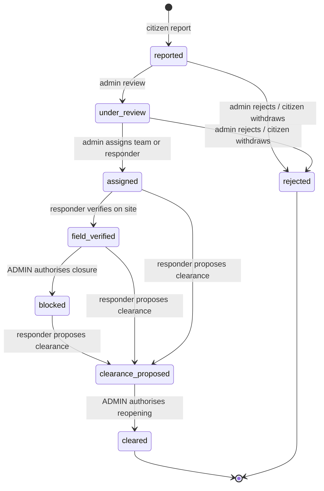

# 05 · Features and User Flows

Every feature below was traced to code and, where stated, exercised during the audit of 15 Nov 2026 (commit `cdafc7d`, branch `feature-demo`). Legend: **[VERIFIED]** observed in code or by running it · **[USER-STATED]** told to the auditor, not provable from the repo · **[LIMITED]** works but with the caveat shown.

Related: [02 Problem→feature table](02_PROBLEM_STATEMENT_AND_SOLUTION.md#9-problem--feature-traceability) · [03 Architecture](03_TECHNICAL_ARCHITECTURE.md) · [07 API](07_API_DOCUMENTATION.md).

## 0. Feature map (ordered by value to the judging criteria)

| # | Feature | Primary user | Status |
|---|---|---|---|
| 1 | Crowd-sourced geotagged hazard reporting (+ photo) | Citizen | Implemented [VERIFIED] |
| 2 | Duplicate merging and crowd-trust confidence | Control room | Implemented [VERIFIED] |
| 3 | Eight-state verified incident workflow | Admin, responder | Implemented [VERIFIED] |
| 4 | Risk-aware route comparison | Citizen, responder | Implemented [VERIFIED] · [LIMITED] |
| 5 | Ripple Engine (cascading impact of a closure) | Admin, planner | Implemented [VERIFIED] · [LIMITED: synthetic trips] |
| 6 | watsonx Orchestrate incident agent with human approval | Admin | Implemented [VERIFIED code/tests/connectivity] · end-to-end run [USER-STATED] |
| 7 | Agent Decision Timeline and Audit Trail | Admin | Implemented [VERIFIED] |
| 8 | Responder workspace (queue, claim, field verification, clearance) | Responder | Implemented [VERIFIED] |
| 9 | Evaluation benchmark | Admin, judges | Implemented [VERIFIED] · [LIMITED] |
| 10 | Live updates (SSE) and notification outbox | All / admin | Implemented [VERIFIED] · delivery [LIMITED] |
| 11 | Live traffic (TomTom) and OSRM geometry | Citizen | Optional [VERIFIED code] · TomTom not exercised live in this audit |
| 12 | Accounts, roles and session security | All | Implemented [VERIFIED] |
| 13 | Guided demo, onboarding tour, voice directions | All | Implemented [VERIFIED code] |
| 14 | Operations: backups, PostgreSQL, reset, Docker/CI | Operators | Implemented [VERIFIED] |

Not implemented: image analysis of photos, Kannada UI, mobile app, push notifications, real BBMP/BTP feeds, rainfall forecast ingestion (see [11](11_LIMITATIONS_AND_ROADMAP.md)).

---

## 1. Hazard reporting (citizen)

| Field | Detail |
|---|---|
| Purpose | Turn a sighting of waterlogging into a structured, located, rate-limited report. |
| Problem addressed | Unstructured, unlocated reports on social media/helplines. |
| Target user | Any signed-in citizen/commuter. |
| How it works | Citizen picks a point (map click, browser GPS or Nominatim place search), a hazard type, severity and description; optionally attaches a photo. The server validates the point is inside the Bengaluru service area, snaps it to the nearest modelled road edge (Haversine, ambiguity flag), stores the report as evidence on an incident and creates or merges the incident. |
| User input | `lat`, `lon`, `type` (`waterlogging`, `drain_overflow`, `fallen_tree_water`, `manhole_hazard`, `road_submerged`), `severity` (`low`…`critical`), `description` (3–2000 chars), optional `evidence_note`, optional `photo_id`. |
| Processing | Pydantic validation → service-area check → rate limit (30 reports/h/account) → photo claimed → snap-to-edge → duplicate check (10 m) → confidence calculation → rule-based triage → agent event logged. |
| AI involvement | None (rule-based). Photos are **not analysed** by any model; a photo only counts as "evidence attached". |
| Output | Incident object with `road_edge_id`, `road_name`, `status`, `confidence`, `agent_summary` (edge mapped, distance, ambiguity, recommendation). |
| Expected benefit | Structured, located input the rest of the pipeline can act on. |
| Dependencies | Road graph; optional Nominatim for place search (browser-side). |
| Status | Implemented [VERIFIED]. Smoke: valid report → 200 with edge mapping; Delhi coordinates → 422; no token → 401. Screenshot `SS02`. |

**Observation from the audit:** in the seeded demo database a report close to the seeded Sony World incident was auto-escalated to `assigned` with a critical severity (it merged onto the existing critical incident). That is the merge feature working, but a first-time viewer may be surprised — pick a different location for a clean "new incident" demo (see [15](15_VIDEO_DEMO_SCRIPT.md)).

## 2. Duplicate merging and crowd-trust confidence

| Field | Detail |
|---|---|
| Purpose | Stop duplicates swamping the control room and stop unverified claims from acting as truth. |
| Problem addressed | Duplicate/low-quality reports; fake or mistaken reports closing roads. |
| Target user | Control-room admin (consumer of the result). |
| How it works | A report within **10 m** (`DUPLICATE_RADIUS_M`) of an open incident is added to it and increments `reports_count`. Each reporter has a **reputation** `(confirmed + 1.5) / (confirmed + rejected + 3)`. Confidence combines reputation, number of independent reporters, photo presence and a triage floor, and is **capped at 0.9 until a human verifies** the incident. |
| Input | Reports (feature 1); admin/responder verdicts feed reputation. |
| Processing | `incident_service.create_report`, `reputation_service.py`. |
| AI involvement | None (deterministic formula; 33 unit tests). |
| Output | `confidence`, `reports_count`, merged evidence list. |
| Expected benefit | Fewer duplicate tickets; transparent, explainable trust. |
| Dependencies | Database. |
| Status | Implemented [VERIFIED] — `test_report_merging.py` (10), `test_crowd_trust.py` (33) pass. |

## 3. Verified incident workflow (state machine)

Transitions are taken from the guards in `incident_service.py` (`admin_review`, `admin_assign_team`, `responder_verify`, `responder_propose_clearance`, `admin_authorize_restriction`, `withdraw_report`). A responder may re-verify an incident that is already `field_verified` or `blocked`.

| Field | Detail |
|---|---|
| Purpose | Make sure no road is closed or reopened without a human on the ground and a human in authority. |
| Problem addressed | No accountability; closures from unverified reports. |
| Target user | Admin (decide), responder (verify), citizen (watch / withdraw own report while `reported`/`under_review`). |
| How it works | Each transition is a role-guarded API call (see the [role matrix](07_API_DOCUMENTATION.md#role-matrix)) and writes an audit row with before/after state. Only `POST /incidents/{id}/restriction` by an **admin** changes the road graph; it increments `graph_version`. Closures are persisted and restored at start-up. |
| Input | Notes, findings, `water_depth_cm`, `is_impassable`, `recommended_action`, optional photo. |
| Processing | Transition guards return `409` with a reason (audit smoke: `authorize_block` on an `assigned` incident → `409 "A responder must field-verify it first."`; withdraw on a `blocked` incident → `409`). |
| AI involvement | The Orchestrate agent may *recommend* a next action; it cannot perform any transition (feature 6). |
| Output | Updated incident, audit event, graph version bump, notifications queued. |
| Expected benefit | Safe, explainable closures and reopenings. |
| Dependencies | Database, road graph. |
| Status | Implemented [VERIFIED] — end-to-end happy path run on the audit database (review → assign → claim → verify → authorise block = `blocked`, 200 at each step); `test_acceptance.py`, `test_admin_workflow.py`. |

## 4. Risk-aware route comparison

| Field | Detail |
|---|---|
| Purpose | Show the commuter the fastest route **and** a route that avoids reported and closed hazards, with the trade-off in minutes and a risk score. |
| Problem addressed | Commuters routed into flooded roads. |
| Target user | Citizen; responder (for a safe detour to the site). |
| How it works | `POST /routes/compare` snaps origin/destination to the graph, runs Dijkstra/Yen with costs = base time × traffic factor + hazard penalty + BPR congestion, excludes admin-blocked edges, and returns the **fastest** and **risk-aware** (and, when it exists, **alternative**) routes. When OSRM is reachable it supplies road-following geometry and turn-by-turn steps; otherwise the graph geometry is used and the UI says so. When a TomTom key is set, live-traffic ETAs/flow are used; otherwise a time-of-day model is used and labelled. |
| User input | Origin and destination (`{lat, lon}` each, inside the service area). |
| Processing | `agent_service.compare_routes`, `graph_service.py`, optional `tomtom_routing_service.py`. |
| AI involvement | None (algorithmic). |
| Output | Per route: `estimated_duration_s`, `base_duration_s`, `hazard_penalty_s`, `congestion_delay_s`, `distance_m`, `blocked_edges_crossed`, `risk_score`, `uncertainty` text, `traffic_source`, `geometry_source`. |
| Expected benefit | Informed choice — the app never claims a route is guaranteed safe (`uncertainty` field says so). |
| Dependencies | Road graph; optional OSRM, TomTom. |
| Status | Implemented [VERIFIED]; **[LIMITED]** the *risk model* covers only the 20-node/56-edge graph (Koramangala, Indiranagar, Domlur, HSR, Ejipura). Audit run (seeded DB, offline): fastest 1148 s/risk 0.18 vs risk-aware 1316 s/risk 0.08, `traffic_source = time_of_day_model`. Screenshot `SS11` shows the offline "Graph fallback (OSRM unavailable)" state — caption it as such. |

## 5. Ripple Engine

| Field | Detail |
|---|---|
| Purpose | Answer "what happens to everyone else if this road closes?" before the control room commits. |
| Problem addressed | No visibility of second-order traffic effects. |
| Target user | Admin; any signed-in user may run read-only what-ifs (rate-limited 10/min). |
| How it works | Re-routes **150 seeded synthetic trips** (seed 42) on the closed graph, applies BPR volume/capacity delay per edge, repeats for `iterations` rounds (1–5), and reports affected trips, mean detour, top affected edges and per-edge Δload. |
| Input | `seed`, `iterations`, optional `custom_blocked_edge_ids` (≤20), optional `trip_count` (10–500). |
| AI involvement | None as an algorithm; the Orchestrate agent can call a sandboxed what-if (`run_ripple_what_if`) as one of its tools. |
| Output | `RippleImpactResponse` (see [07](07_API_DOCUMENTATION.md)). Also run automatically when a closure is authorised (`GET /simulations/latest`). |
| Expected benefit | Closure decisions made with the knock-on effects visible. |
| Dependencies | Graph, `synthetic_trips.json`. |
| Status | Implemented [VERIFIED]; **[LIMITED]** trips are synthetic, not measured. After the audit workflow above closed one road: 25 of 150 trips affected. Screenshot `SS07`. |

## 6. watsonx Orchestrate incident agent (agentic AI)

| Field | Detail |
|---|---|
| Purpose | Let an LLM agent investigate an incident with the system's own tools and propose the next action with reasons. |
| Problem addressed | Slow, inconsistent triage and dispatch decisions. |
| Target user | Control-room admin. |
| How it works | Admin → incident card → **Ask agent** (or *watsonx Orchestrate Agent* tab → **Ask the agent**) (`POST /agents/analyze/{id}`). MaleMitra gets an IBM IAM token and sends a prompt to the `malemitra_incident_agent`. The agent calls MaleMitra's eight REST tools (`/agent-tools/*`, API-key protected), finishes with `submit_recommendation`, and the recommendation is stored with `requires_approval`. The admin **approves** (runs the normal gated workflow action, with audit) or **dismisses**. |
| User input | Incident id; optional free-text chat (`POST /agents/chat`). |
| Processing | `orchestrate_client.py`, `agent_tools_service.py`, `recommendation_service.py`. Guardrail: an action invalid for the incident's current status is rejected with `422 workflow_gate` and the agent re-plans. |
| AI involvement | **Yes — the only LLM in the system.** The three other "agents" in the timeline are rule-based Python and are labelled so in the UI. |
| Output | Reply text, stored recommendation (`request_triage`, `assign_team`, `reject_duplicate`, `request_field_verification`, `propose_block`, `propose_reopen`, `monitor`, `escalate`) with rationale and confidence. |
| Expected benefit | Faster, evidence-cited triage while humans keep every consequential decision. |
| Dependencies | IBM watsonx Orchestrate instance, IBM IAM, a publicly reachable `PUBLIC_BASE_URL` for tool callbacks, `AGENT_TOOL_API_KEY`. |
| Status | Code, 37 tests and the offline guard-rail smoke: **[VERIFIED RUN]** (agent can't change status; `propose_block` on a non-verified incident → 422; admin approval moved incident to `under_review`). Live IAM token and a live chat round-trip to the team's agent: **[VERIFIED RUN]** 15 Nov 2026. Full tool-callback loop: **[USER-STATED: works]** — not re-run during the audit because the tunnel URL was unreachable. Evidence screenshots: ORCH-1…7 in [SCREENSHOT_REQUIREMENTS](SCREENSHOT_REQUIREMENTS.md). Details: [04 Part B](04_IBM_TECHNOLOGY_AND_AGENTIC_AI.md). |

**Example (audit run, offline, no LLM — tools called directly as the agent would):** a new report arrives at `reported` → `submit_recommendation(action="request_triage", confidence 0.8)` accepted and logged → status of the incident unchanged → admin approves → incident `under_review`, audit row written.

## 7. Agent Decision Timeline and Audit Trail

| Field | Detail |
|---|---|
| Purpose | Make every automated and human step inspectable. |
| Target user | Admin. |
| How it works | *Agent Decision Timeline* lists `agent_events` (agent, action, inputs, result, `requires_approval`, decision). *System Audit Trail* lists `audit_events` (actor, action, entity, `before_state`, `after_state`). Rule-based vs LLM rows are tagged. |
| AI involvement | Displays AI output; adds none. |
| Status | Implemented [VERIFIED] — `GET /events/agent`, `GET /events/audit` (admin only; a citizen gets `403`). Screenshots `SS04`, `SS06`. |

## 8. Responder workspace

| Field | Detail |
|---|---|
| Purpose | Give field staff one place for tasks and evidence. |
| Target user | Responder (demo: "Inspector Ramesh", Team Alpha). |
| How it works | **My tasks** (assigned to me) and **Team queue** (unclaimed work for my team). A free responder **claims** a queue item atomically. On site they submit field verification (findings, water depth, impassable yes/no, recommended action, optional photo). After dewatering they **propose clearance**. A safe-detour route finder avoids blocked roads. |
| Input | See API for `verify`, `clearance`, `claim`. |
| Processing | `ResponderWorkspace.tsx`, `incident_service.claim_incident/responder_verify/responder_propose_clearance`. |
| AI involvement | None. |
| Status | Implemented [VERIFIED] — audit run: verify → 200; `GET /teams/me/tasks` returns tasks and queue; a responder updating another team's status → `403`; `test_responder_assignment.py` (19). **[LIMITED]** accounts are demo accounts; no real municipal integration. Screenshot `SS09` (empty-state). |

## 9. Evaluation benchmark

| Field | Detail |
|---|---|
| Purpose | Reproducible comparison "closed road ignored" vs "MaleMitra rerouting". |
| Target user | Admin, judges. |
| How it works | `python backend/eval_benchmark.py` (CLI) or admin endpoint `GET /simulations/benchmark/run` closes the Sony World corridor (`edge-7`, `edge-8`) and counts how many of the 150 trips cross it before/after rerouting. |
| Result (CLI, 3 repeats, identical) | **38 of 150 trips (25.3 %) cross the closed road in the baseline → 0 with MaleMitra**; mean trip time 366.7 s → 381.0 s (**+14.2 s, +3.9 %**); 0 stranded; runtime ≈ 4–5 ms. |
| Caveat | The **in-app** endpoint runs on live graph state (existing hazard penalties), so its time figures differ from the CLI figures (+20.9 s/+5.7 % on a fresh DB in one run; +38.6 s/+10.5 % on the audit DB after a closure). The "38 → 0" result was identical in every run. Quote the CLI numbers and state the conditions. The committed `benchmark_results.json` shows +289.6 % and should not be quoted. |
| Status | Implemented [VERIFIED]; simulation on a 20-node model — **not field data**. Screenshot `SS08` (shows in-app figures; caption accordingly). |

## 10. Live updates and notifications

- **SSE** (`GET /events/stream`): every ~2.5 s sends `graph_version` and the list of blocked edge ids. It is deliberately **unauthenticated and public** — it carries only the same road-network state as `GET /routes/network`, because browsers' `EventSource` cannot send an `Authorization` header. Connections capped at 100. [VERIFIED in code]
- **Notification outbox:** events (e.g. password reset, assignments) are queued in the database and dispatched by a background loop with lease, retry and back-off — email through SMTP, SMS through a signed webhook (`X-MaleMitra-Signature`, HMAC-SHA256). With neither configured the message is only logged. Status: tested (20 tests); delivery verified only against a local SMTP server and test webhook [LIMITED]. In the audit DB 7 messages were `pending` and 1 `sent` in log-only mode.

## 11. Live traffic and routing geometry (optional)

- **TomTom** flow polling and routing ETAs: off without `TOMTOM_API_KEY`; daily request budgets, cache and circuit breaker. Tests use recorded-shape responses. Live key present in the team's local `.env`, **not exercised** in this audit.
- **OSRM**: road-following geometry and turn-by-turn; self-hosted via Docker Compose or the public demo server; falls back to graph geometry (circuit breaker after 3 failures).

## 12. Accounts, roles and sessions

Three roles (citizen, responder, admin). Public sign-up creates **citizens only** unless `DEMO_MODE=true`; otherwise an admin creates responders/admins (`POST /auth/users`; audit run created a responder → 200). Passwords: ≥ 8 chars with upper, lower, digit and special character; stored with scrypt. Sessions are HMAC-signed, expire after 8 h and are revoked on logout or password change. Five failed logins lock the email for 15 min (`429` with `Retry-After`). Password reset: one-time token, 30 minutes, stored hashed. Details and caveats: [09](09_SECURITY_PRIVACY_AND_RESPONSIBLE_AI.md).

## 13. Guided demo, tour and voice

*Demo Guide* (8 scripted steps from report to reopening), role-specific *Onboarding Tour*, one-click demo logins on the login page, and browser `speechSynthesis` voice narration of turn-by-turn directions (feature depends on the user's browser). Implemented [VERIFIED in code]; only the login page and workspaces were screenshot.

## 14. Operations

`backend/scripts/backup.py`, `migrate_sqlite_to_postgres.py`, `reset_demo.py`; Dockerfile (non-root), `docker-compose.yml` (app + PostgreSQL 16 + OSRM), `render.yaml`, `scripts/deploy_code_engine.sh`, GitHub Actions CI (**the lint step currently fails on one `F821` — see [08](08_TESTING_AND_VALIDATION.md)**). Public deployment `https://malemitra.onrender.com/api/v1/health` returned HTTP 200 on 15 Nov 2026.

---

## User journeys

### Journey A — Citizen reports and reroutes (≈ 2 min)
1. Sign in (demo: *Citizen (Pooja)*).
2. Pick the commute start/end → **Find Routes** → see Direct vs MaleMitra route cards with minutes and risk.
3. Spot a flooded underpass → click the map there → choose type/severity, add a description (+ photo) → **Submit**.
4. The report appears in **Active Monsoon Hazard Reports**; the citizen can **Withdraw** it while it is `reported` or `under_review`.
5. Later, when the control room closes the road, the live map updates by SSE and **Find Routes** avoids it.

### Journey B — Control room triage with the agent (≈ 3 min)
1. Admin signs in → **Road Map & Overlay** shows hazards and closures.
2. Open the incident → **Review** (triage) → optionally **Ask agent** (the recommendation card); read the recommendation, rationale and confidence.
3. **Approve** (button text depends on the action, e.g. "Approve & dispatch team") or **Dismiss**; on approval the normal workflow action runs.
4. **Assign** a team/responder (the `ResponderPicker` shows who is free).
5. After the responder verifies, **Authorise Block** — the road graph version increments and the ripple result is generated.
6. Check **Agent Decision Timeline** and **System Audit Trail**.

### Journey C — Responder in the field (≈ 2 min)
1. Sign in as a responder → **Team queue** → **Claim**.
2. On site: submit findings, depth, impassable flag, recommended action (+ photo).
3. After dewatering: **Propose clearance**.
4. The admin authorises reopening; the road returns to the routing graph.

### Journey D — Planner explores impact (≈ 1 min)
Admin → **Ripple** view → run simulation → read "38 rerouted trips (25 %)", top affected roads, mean detour; open **Benchmark** for the baseline-vs-MaleMitra comparison (quote CLI numbers).

## Reproducible example (audit database, offline, `DEMO_MODE=true`)

| Step | Call | Result observed |
|---|---|---|
| 1 | Citizen `POST /reports` (12.9610, 77.6387, drain_overflow, medium) | `inc-…` created on `edge-33` Domlur Flyover / Old Airport Road, snapped 7 m, `status=reported`, confidence 0.85 |
| 2 | Admin `POST …/review` | `under_review` |
| 3 | Citizen tries `…/review` | `403` |
| 4 | Admin `POST …/assign` team-alpha | `assigned` |
| 5 | Responder `POST …/claim` | claimed |
| 6 | Admin `POST …/restriction authorize_block` too early | `409` — must be field-verified first |
| 7 | Responder `POST …/verify` (55 cm, impassable) | `field_verified` |
| 8 | Admin `POST …/restriction authorize_block` | `blocked`; graph version bumped |
| 9 | `POST /simulations` | 150 trips, 25 affected |
| 10 | Citizen `POST …/withdraw` | `409` — a blocked incident can't be withdrawn |

These were executed by the auditor against a throwaway database; they illustrate behaviour and are not user-study results.
