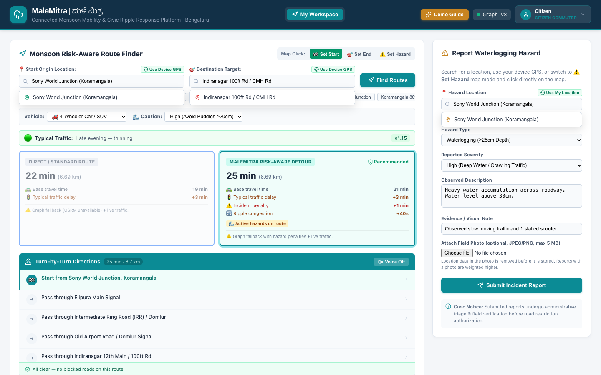
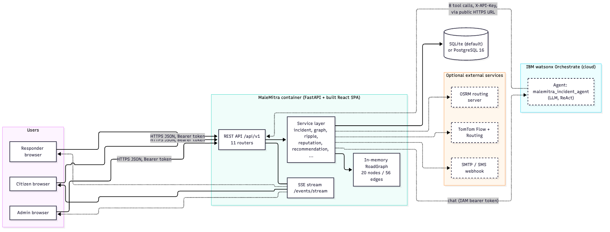
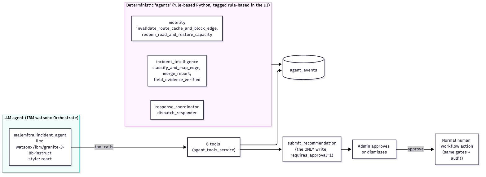
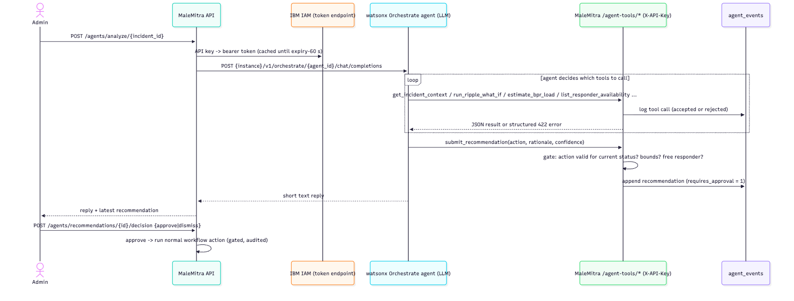
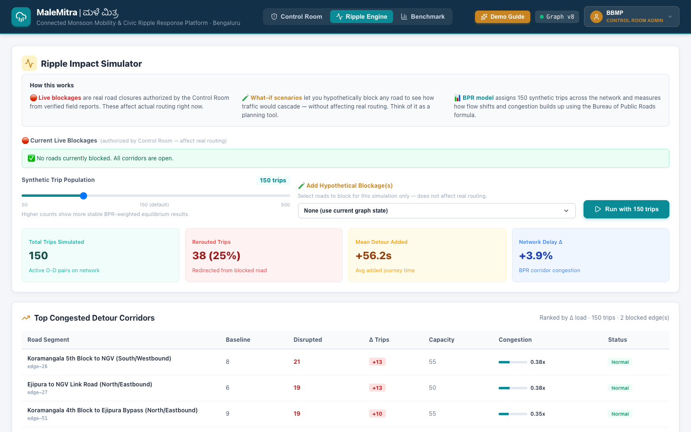

# MaleMitra: Presentation Source (Markdown)

Editable source of `../IBM_Bobathon_Presentation.pptx` (15 slides). The PPTX is generated by [`build_deck.py`](build_deck.py), which holds the exact layout. Edit text there and re-run, or edit the PPTX directly in PowerPoint.

```bash
python3 -m venv /tmp/pptx_env && /tmp/pptx_env/bin/pip install python-pptx==1.0.2 pillow
/tmp/pptx_env/bin/python submission/presentation_source/build_deck.py
```

Alternative conversion from this Markdown with Marp (not tested here): `npx @marp-team/marp-cli SLIDES.md -o deck.pptx`. Image paths are relative to this folder.

**Rules for this deck.** Only real screenshots and exported diagrams are used. Evidence that does not exist yet is an amber placeholder box. Benchmark figures are CLI figures only and are labelled simulation.

---

## 1. Title
**MaleMitra (ಮಳೆ ಮಿತ್ರ)**
*When the rain comes, the road you are sent down should already know it is flooded.*
Track: Smarter Streets, Better Living · IBM Bobathon: Build for Bengaluru 2026
Team: [TEAM INPUT REQUIRED]

## 2. The problem: who it hurts, what must improve (required item 1)
- Commuters and riders see water but cannot report it to anyone who can act. Navigation does not know local hazards.
- Control room gets scattered reports and cannot spot duplicates or judge credibility.
- Field responders are dispatched without a shared, current incident record.
- **What must improve:** one shared, verified picture that every route reacts to.
- Why Bengaluru: monsoon runs June to September; 2022 had over 1,700 mm vs a mean of about 860 mm; built-up land about 8 % (1973) to 87.6 % (2025); fewer than 200 of over 1,400 lakes and tanks survive. Sources: [Bengaluru](https://en.wikipedia.org/wiki/Bengaluru), [Lakes in Bengaluru](https://en.wikipedia.org/wiki/Lakes_in_Bengaluru), [Infrastructure in Bengaluru](https://en.wikipedia.org/wiki/Infrastructure_in_Bengaluru). No casualty, cost or response-time claims.

## 3. The prototype: one loop, report to reroute (required item 2)
Citizen reports and routes · Control room triages, dispatches and alone closes roads · Responder verifies on site · Ripple Engine shows where traffic goes.
Built with IBM Bob, plus an IBM watsonx Orchestrate agent that recommends. A human approves every action.

## 4. The Bob story: how we built it (required item 3, core requirement)
Three beats, each with a placeholder for your own capture:
1. **Start**: first task given to Bob. [TEAM INPUT REQUIRED] · BOB-1
2. **Build and fix**: a real failure Bob helped fix, a real diff applied. [TEAM INPUT REQUIRED] · BOB-2 / BOB-3
3. **Review and trust**: who reviewed, plus 242 passing tests. [TEAM INPUT REQUIRED] · BOB-5

## 5. Bob evidence in the repository
- Verified: 7 local git notes, 95 Bob edits (94 `apply_diff`, 1 `insert_content`), 15 Nov 2026, 22:38 to 23:36 IST.
- Files: map component 32, routing module 27, responder workspace 22, demo guide 10, incident service 3, one test.
- Checked with 242 passing backend tests, a deterministic benchmark, type-check and build in CI.
- Team-stated, evidence pending: earlier work on another machine, all commits on all branches. [TEAM INPUT REQUIRED]
- **Placeholders:** BOB-4, BOB-5.

## 6. How it works
Report → snap to road and merge → admin triage → dispatch → field verify → admin authorises closure → routes re-plan → clearance, then reopen.


## 7. The working product
Six real screenshots: SS02 citizen, SS03 control room, SS09 responder (empty state), SS11 routes, SS07 ripple, SS06 audit trail.

## 8. Technical architecture

FastAPI + React/TypeScript, SQLite or PostgreSQL, Leaflet. Optional OSRM, TomTom, SMTP, each with a fallback. The agent reaches MaleMitra only through 8 API-key-protected tools.

## 9. Agentic AI: bounded autonomy

One LLM agent (watsonx Orchestrate). Three rule-based Python modules (Incident Intelligence, Response Coordinator, Mobility). No agent-to-agent coordination.

## 10. IBM watsonx Orchestrate in the loop

8 tools. Only `submit_recommendation` writes, and it stores a recommendation awaiting approval. Wrong-state action gets 422 and the agent re-plans.
- **Placeholders:** ORCH-1/2 (console), ORCH-3/4 (panel, recommendation).

## 11. What is different
Closed loop, not just a map · Trust-weighted crowd data · Ripple Engine · Agentic but governed.

## 12. Impact: one measurable outcome (required item 4)
- **38 → 0** trips on the closed road (of 150). **+14.2 s (+3.9 %)** mean trip time.
- K3 to K6 instrumented, baselines require measurement.
- 20-node model, five neighbourhoods, synthetic trips, seed 42. Not field data. `python backend/eval_benchmark.py`.


## 13. Feasibility and scalability
- Verified: 242 backend tests passed; frontend build passes; backend starts from a fresh venv; 53 API operations; hosted health 200.
- Designed, not load-tested: PostgreSQL and multi-worker, OSRM, Docker/Render/Code Engine.
- Not yet done: PostgreSQL and Docker runs, load test, accessibility audit, frontend tests.

## 14. Privacy and human review by design
- Implemented: recommend-only agent, state-gated recommendations, closed-by-default tools, no reporter PII to the agent, full logging.
- Recommended: sanitise citizen text, mask `evidence_list` reporters (known gap), evaluate agent quality, retention jobs, security testing.

## 15. Closing
The problem: commuters, control room and responders on different channels · The prototype: working, role-based, built with IBM Bob · The Bob story: small reviewed diffs, 242 passing tests · The impact: 38 to 0 trips on a closed road in simulation. A human approves every agent action.
Repo: github.com/sakshit-allumolu/MaleMitra (branch `feature-demo`). Demo URL and contact: [TEAM INPUT REQUIRED].

---

Speaker notes for every slide are embedded in the PPTX (Notes pane) and in `build_deck.py`.
